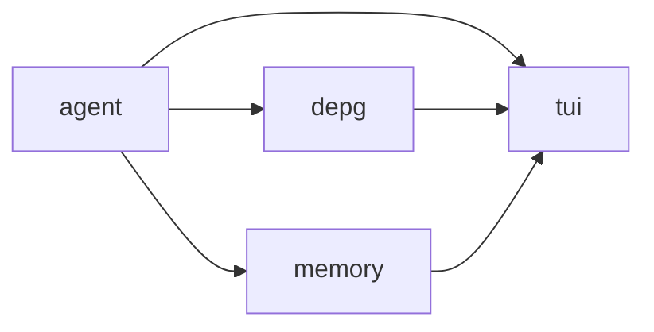

# CISM codebase map

SLM-driven VAPT agent. Terminal-only surface (Textual TUI); a LangGraph state
machine drives think/act/extract; a DEPG (dependency/error-propagation graph,
`cism/depg/`) tracks findings as evidence-backed nodes, separate from the
`scripts/codegraph.py` module graph below (that one's about this codebase's
own imports, not the app's findings).

## Request lifecycle (cism/agent/graph.py::build_graph)

```
think -> act -> depg_update -> phase_router -> memory_update -> (think | respond)
```

- **think** (`nodes.py::make_think_node`) — binds this phase's tools, streams
  a reply. If the model has no native tool-calling and the phase offers
  tools, falls back to parsing a `TOOL_CALL: {...}` block from the text
  (`_parse_text_tool_call`).
- **act** (`nodes.py::make_act_node`) — runs each tool call through the
  action `GuardrailChain`, then `tool.ainvoke`. Failures become a `ToolMessage`
  (content, not an exception) so the model can see and react to them.
- **depg_update** (`nodes.py::make_depg_update_node`) — runs each tool
  result through its `CauseExtractor` (off-thread, see `ExtractorRegistry`
  below), upserts nodes/edges into the DEPG.
- **phase_router** (`nodes.py::make_phase_router`) — advances
  `PhaseStateMachine` only when `_phase_ready` finds real DEPG evidence for
  the current phase (not "any successful call" — that was AUDIT.md B1).
- **memory_update** — folds notable messages into `MemoryStore`.
- **respond** — final turn back to the TUI when no more tool calls are queued.

## Module map

| Package | Owns | Key files |
|---|---|---|
| `cism/agent/` | LangGraph wiring, state, prompts, guardrails, LLM client | `core.py` (`LangGraphAgent`, the public entry point), `graph.py` (node wiring), `nodes.py` (think/act/depg_update/phase_router/memory_update), `state.py` (`Phase`, `PhaseStateMachine`, `AgentState`), `profiles.py` (`PhaseProfile`/`PhaseProfiles` — per-phase prompt + tool subset), `guardrails.py` (chain-of-responsibility stages: scope, dangerous-flag, phase-tool-guard), `llm.py` (`build_chat_model`, `DummyChatModel`, `discover_context_window*`), `logging.py` |
| `cism/agent/tools/` | Tool catalog, sandboxing, registry | `catalog.py`/`catalog.yaml` (declarative tool specs -> `CATALOG`), `registry.py` (`ToolRegistry`, name -> bound tool), `sandbox.py` (`BubblewrapRunner`), `credentials.py` (hydra wordlists), `dummy.py` (offline stand-ins: `dummy_nmap`, `dummy_msfconsole`), `base.py` |
| `cism/depg/` | The dependency/error-propagation graph (the app's own finding graph — not this codebase's import graph) | `graph.py` (`Graph`, `settle()`/`prune()`), `node.py`/`edge.py`/`evidence.py` (data model), `reducer.py` (`reduce_state`, `SupportPolicy`/`BinarySupport` — state derivation seam), `extract.py` (`CauseExtractor` protocol, `GenericExtractor`, `ExtractorRegistry`), `extractors.py` (`NmapExtractor`/`HydraExtractor` — regex, deterministic `cause_class`; `LLMExtractor` — free-text fallback, pluggable via `ExtractionBackend`: `ChatModelExtractionBackend`/`LlamaCppExtractionBackend`), `linking.py` (`find_precondition`), `normalize.py` (`normalize_target`) |
| `cism/memory/` | Cross-turn salience-ranked memory | `store.py` (`MemoryStore`), `item.py` (`MemoryItem`) |
| `cism/tui/` | Textual app, rendering, replay | `app.py` (`CISMApp`), `events.py` (view-model events, e.g. `DEPGNode.label`), `redact.py`, `replay.py` (offline log replay), `widgets/` (`transcript.py`, `composer.py`, `status.py`, `depg_modal.py`, `memory_modal.py`, `slash.py`, `spinner.py`, `_fmt.py`) |
| `run_agent.py` | CLI entry point (real LangGraph agent + TUI) | `--backend`, `--live-tools`, `--scope` flags |
| `demo_replay.py` | CLI entry point (replays a recorded log, no LLM/network) | |
| `tests/` | Mirrors `cism/` ~1:1 (`test_<module>.py`); `test_snapshots.py` is Textual pixel-snapshot tests — **known flaky under repeated/parallel runs independent of code changes** (confirmed via `git stash` + repeat-run, not a regression signal) | |
| `docs/superpowers/` | Per-feature plan/design docs from when each piece was built (dated, historical — not a live architecture doc) | |
| `AUDIT.md` | Standing engineering-audit findings + status notes, prioritized P0/P1/P2 | |

## Extensibility seams (where new code plugs in)

- **New tool** → add to `cism/agent/tools/catalog.yaml` (or a decorated
  function + `_DECORATED_TOOL_PHASES`/`_DECORATED_TOOL_CAPABILITIES` in
  `profiles.py` if it's hand-written like `hydra`).
- **New extraction logic for a tool's output** → implement `CauseExtractor`,
  register in `EXTRACTORS`/`ExtractorRegistry`.
- **New inference backend** → implement `ExtractionBackend` (`extractors.py`)
  for DEPG extraction; chat/tool-calling itself works on any OpenAI-wire
  server already (`build_chat_model`).
- **New guardrail check** → implement a `GuardrailStage`, add to the input,
  action, or output `GuardrailChain` in `core.py`/`profiles.py`.
- **New phase behavior** → edit `_PROMPTS`/`_phase_ready` — phase legality
  itself lives in `PHASE_TRANSITIONS` (`state.py`).

## Module dependency graph

Auto-generated from actual imports — do not hand-edit between the markers,
regenerate instead:

```bash
.venv/bin/python scripts/codegraph.py
```

<!-- codegraph:start -->

<!-- codegraph:end -->

## Keeping this skill current

Update the prose sections above by hand whenever a module's responsibility
changes, a new package is added, or a seam moves. Regenerate the diagram
(`scripts/codegraph.py`) whenever an edit changes which subpackages import
which. Not needed for routine bugfixes/tests that don't change structure.
